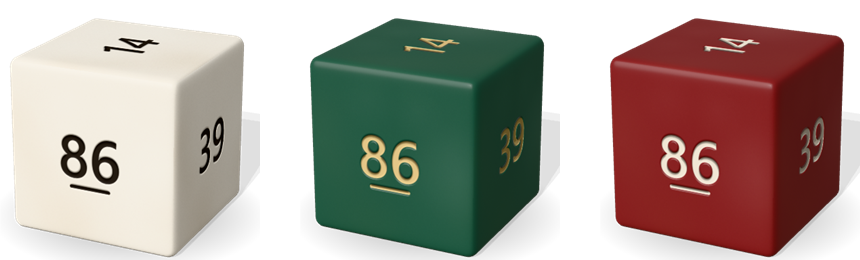
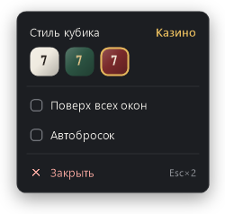

# Кубик

3D-кубик с числами 1–100 прямо на рабочем столе — рандомайзер для смешанных стратегий в покере.
Прозрачное окно без рамки: на экране только кубик, а что значит выпавшее число — решаешь сам.



## Запуск

Скачать `PokerDice-1.0.0.zip` из [релиза](../../releases/latest), распаковать и запустить `PokerDice.exe`.
Нужен [.NET 10 Desktop Runtime](https://dotnet.microsoft.com/download/dotnet/10.0) для Windows x64.

## Возможности

- **Бросок** — левый клик или пробел. Каждый раз по-разному: кручение, кувырок или волчок.
- **PgUp — бросок из любого окна**, не отрываясь от покерного клиента: кубик всплывает поверх, фокус остаётся у игры.
  Пока кубик запущен, PgUp в других программах не работает.
- **Автобросок** — кубик бросается сам раз за разом, между бросками число видно ~1,6 с.
  Клик, пробел или PgUp останавливают: последний бросок докатится и покажет число.
- Перетаскивание — подвинуть кубик (место запоминается, за край экрана не уходит).
  Колёсико — размер от 50 до 250%.
- Правый клик — меню: стиль кубика, «поверх всех окон», автобросок, закрыть. Esc×2 — тоже закрыть.



Случайность честная — криптографический генератор Windows, все числа от 1 до 100 равновероятны.
Отдельные рандомайзеры разрешены правилами GGPoker (и Покерка) — кубик не читает стол и ничего не нажимает в клиенте.

## Сборка

```
dotnet publish native -c Release -r win-x64 --self-contained false -p:PublishReadyToRun=true -o app
```

C# + WinForms (`native/`), кубик рисуется лучами на процессоре — без браузера и видеокарты, ~30 МБ памяти.
Настройки — `%APPDATA%\PokerDice\prefs.json`. Проверка без окна: `PokerDice.exe --shot <папка>` —
сохраняет картинки кубика и меню и проверяет броски, меню у краёв экрана и автобросок.
